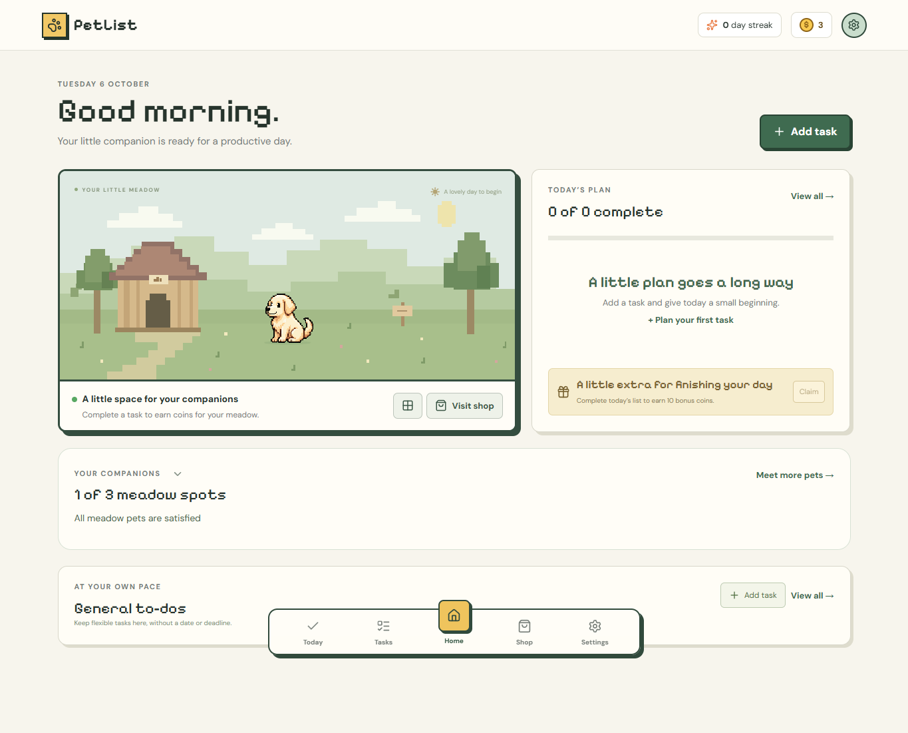

# PetList

**A daily planner with pixel pets and small rewards for getting things done.** Tasks stay at the center of the experience: plan a day, keep flexible to-dos, track progress, and let your pets celebrate each completed task.

[Try the live app](https://pixel-list.pages.dev/) · [View the source](https://github.com/sammeowwww/pet-list)



## Try it in two minutes

1. Open the [live app](https://pixel-list.pages.dev/). You can use it as a guest without signing in; guest progress stays in that browser.
2. Choose **Start tour** for the illustrated walkthrough, or **Skip** to explore. The tour can be replayed in Settings.
3. Select **Settings → Try an example week** to load sample tasks. This replaces the planner in the current browser, so use a fresh guest session or export any progress first.
4. Open **Today**, change a task from To do to In progress, then complete it. Completion earns 5 coins and has a 10-second Undo option.
5. Visit **Home** to feed Bob by clicking him, then use **Shop** to browse pets and decorations.

Google sign-in is optional for this demo. If enabled for your Google account, signing in syncs your planner between devices. The app itself is hosted on Cloudflare Pages; this repository holds its source code.

## User guide

| Area | What you can do |
| --- | --- |
| **Today** | Pick a date, see planned tasks and overdue work, create tasks, and move them through To do → In progress → Completed. Use the General view for flexible work. |
| **Tasks** | See all categories by default, or choose **General** for tasks without a date or deadline. Filter to one category, search names and notes, show or hide completed rows, and browse older completed work. Each day's tasks are ordered To do, In progress, then Completed. |
| **Home** | See your day's plan, the animated meadow, active pets, and a short list of General to-dos. A task completion gives your pets a brief celebration. Feed a hungry pet by clicking or tapping it, or use its feeding card. |
| **Shop** | Spend earned coins on pets and decorations. Bob starts free; you can keep up to three pets in the meadow and place purchased decorations there. |
| **Settings** | Replay the walkthrough, edit categories and your default category, sign in for sync, review sync conflicts, and export or import a JSON backup. |

When creating a task, start with a name and category. **Optional details** contain the planned date, deadline, notes, and Repeat setting. Repeat supports Daily, Weekdays, or selected weekdays. Only one unfinished occurrence of a repeating task exists at a time; missed work stays visible as overdue. A new occurrence appears after you complete the previous one and its Undo window ends.

Every task completion earns **5 coins**. Finishing a nonempty Today list can also earn a **once-per-day 10-coin bonus**. Feeding is free. The first three different pets fed each Singapore day give 3 coins each; a pet stays hungry until fed. Dates and daily resets use **Asia/Singapore** time.

Guest data is stored on that device and browser. To use the same planner on your phone and laptop, sign in with the same Google account in Settings. Offline edits queue locally and sync when connected; Settings shows changes that need review. Export a backup before replacing a planner with example data, an import, or another device's progress.

## Built with

- **React, TypeScript, and Vite** for the interface, with locally bundled pixel and body fonts.
- **Cloudflare Pages Functions and D1** for account-based sync; Google Identity Services for sign-in.
- **Local storage and a durable action queue** for guest use and offline editing.
- **Vitest and Playwright** for domain, API, and desktop/phone browser checks.

The interface began with a Figma-generated TaskTails layout, then was adapted for PetList. The task, reward, recurrence, pet, backup, and sync behavior and the animated meadow are implemented in this project. `src/domain` holds planner rules; `src/components` and `src/hooks` connect those rules to the interface. The earlier design and implementation references are retained under `reference/`.

## Run locally

Requires a recent Node.js installation.

```sh
npm install
npx wrangler d1 migrations apply petlist --local
npm run build
```

Start `npm run dev:api` and `npm run dev` in separate terminals, then open `http://127.0.0.1:5173/`. The Vite server proxies `/api` to the local Pages Functions server. Guest mode works without Google configuration. For local Google sign-in, authorize the exact local origin in the Google OAuth web client.

```sh
npm test
npm run test:e2e
npm run build
```

Production currently uses a **manual Cloudflare Pages deployment**. Merging a GitHub pull request does not automatically update the live app. The Pages project is named `pixel-list`, and its build output is `dist`.

## Data and security notes

Each signed-in user's planner is stored separately in D1. The server validates Google's ID token and login challenge, creates an HttpOnly session cookie, and checks the request origin on writes. Browser-side storage keeps guest progress and offline changes. Backups are JSON files that the user exports explicitly. `.gitignore` excludes local environment files, generated builds, caches, and device data.

The Google OAuth **client ID** in `wrangler.jsonc` is public configuration, not a client secret. Keep API tokens, client secrets, session data, and exported backups out of the repository. Making the repository public exposes its source, history, screenshots, and reference assets; it does **not** expose the D1 database contents or Cloudflare account credentials by itself.
